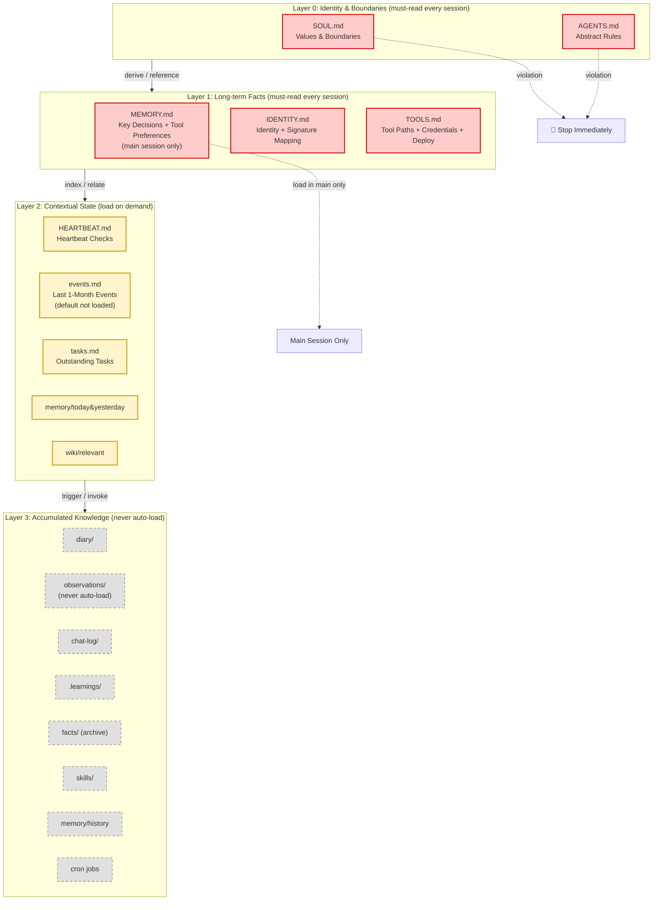
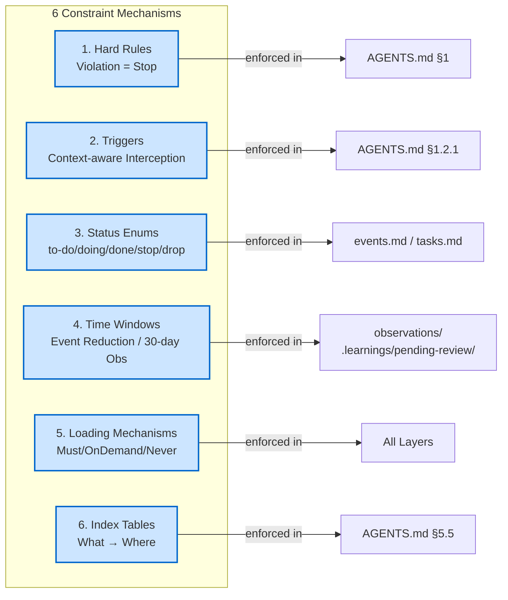
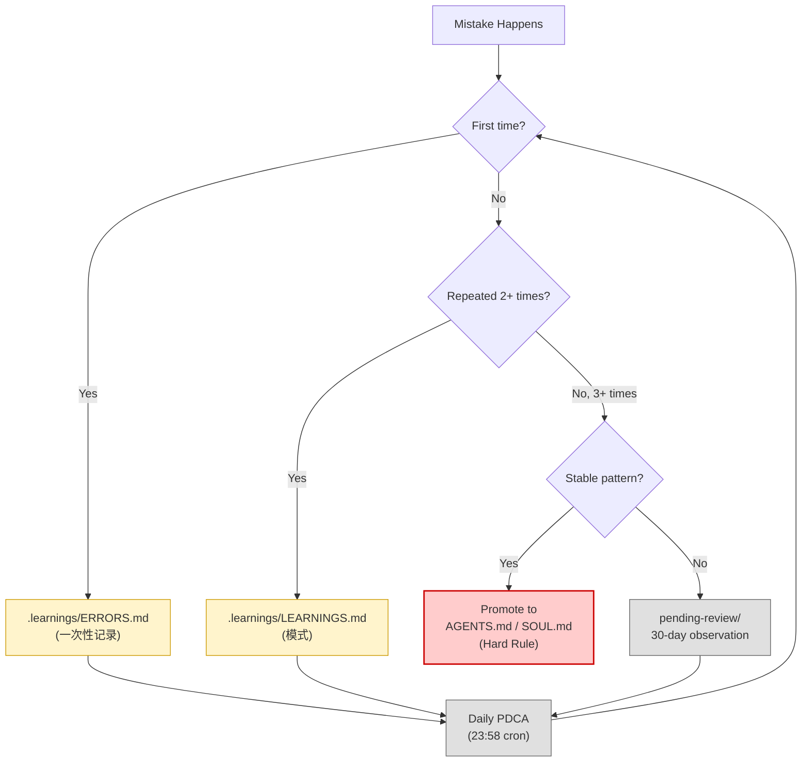
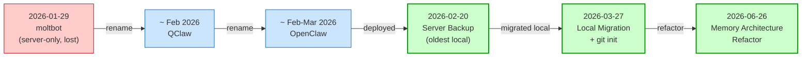

# Architecture Diagram

> 架构图（mermaid 格式，GitHub 原生渲染）

## 完整四层架构图

## 6 种约束机制关系图

## 知识分级写入流程图

## 演进路径图（159 天）

---

## 渲染说明

在 GitHub 上查看 `.md` 文件时，mermaid 代码块会自动渲染为图表。本文件可直接在 GitHub 上预览。

如果需要在本地预览：
- VS Code：安装 "Markdown Preview Mermaid Support" 插件
- Obsidian：原生支持
- Typora：原生支持